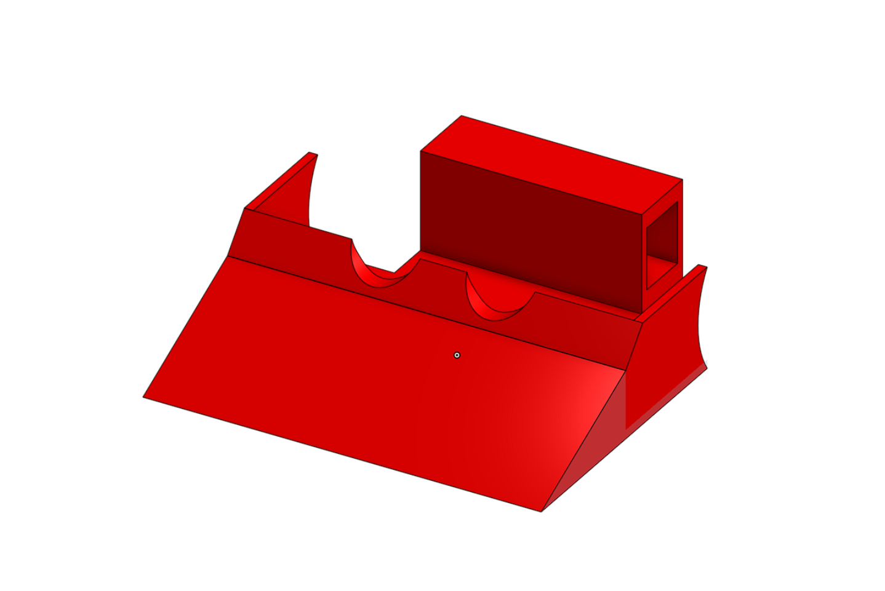

# Autonomous Mini Sumo Robot

**Robotics | Electronics | Mechanical Design | Embedded Systems**

An autonomous Mini Sumo robotics project combining mechanical design, electronic components, sensors, and embedded programming.

The project explores the design and development of a competitive robot capable of detecting opponents, identifying arena boundaries, and controlling its movement autonomously.

---

## 3D Chassis Design

The chassis was designed using Onshape, with attention to mechanical structure, component placement, and fabrication.

## Engineering Files

| File | Description |
| --- | --- |
| [Technical Drawing](mechanical/mini-sumo-chassis-technical-drawing.pdf) | Dimensioned engineering drawing |
| [3D CAD Model](mechanical/mini-sumo-chassis-v01.step) | STEP model of the robot chassis |

## Project Structure

- **firmware/** — Embedded programming and control algorithms
- **hardware/** — Electronic components and wiring
- **mechanical/** — CAD models and engineering drawings
- **docs/** — Technical documentation and testing
- **media/** — Project photographs and visual evidence

## Development Documentation

Additional documentation will describe the robot's electronic system, sensor integration, control algorithms, and performance testing.

---

**Developed by Manuel Fernandez**

[GitHub Profile](https://github.com/tinkerfyecu)
